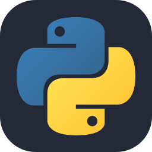
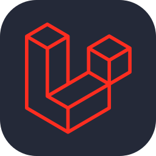
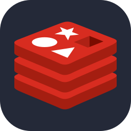

Hi all 👋

<h1>I'm Amal NS</h1>

 I am a Backend Developer

Passionate about building efficient, scalable, and reliable backend applications.

<h4>👨‍💻 About Me</h4>
  • 🧩 Driven by problem-solving and thoughtful software design.  
  • 🛠️ Focused on writing clean, maintainable, and reliable code.  
  • 📚 Always learning, experimenting, and refining my craft.  

---

<h4>🛠️ Technical Skills </h4>
<h5>Programming Languages</h5>

  
  
  
  
  

<h5>Backend & Frameworks</h5>

  
  
  
  
  

<h5>Databases & Caching</h5>

    
    
    
    

<h5>Tools & Technologies</h5>

    
    
    
    
    

<h5>Frontend & Frameworks</h5>

    
    
    

---

<h4>💡 Engineering Philosophy</h4>
I believe good software engineering goes beyond making things work.

It's about understanding problems, choosing appropriate solutions, writing maintainable code, and building systems that are easy to understand, extend, and improve.

I'm particularly interested in the principles and practices that make software reliable, scalable, and maintainable over time.

---

Always learning. Always building. Always improving.
